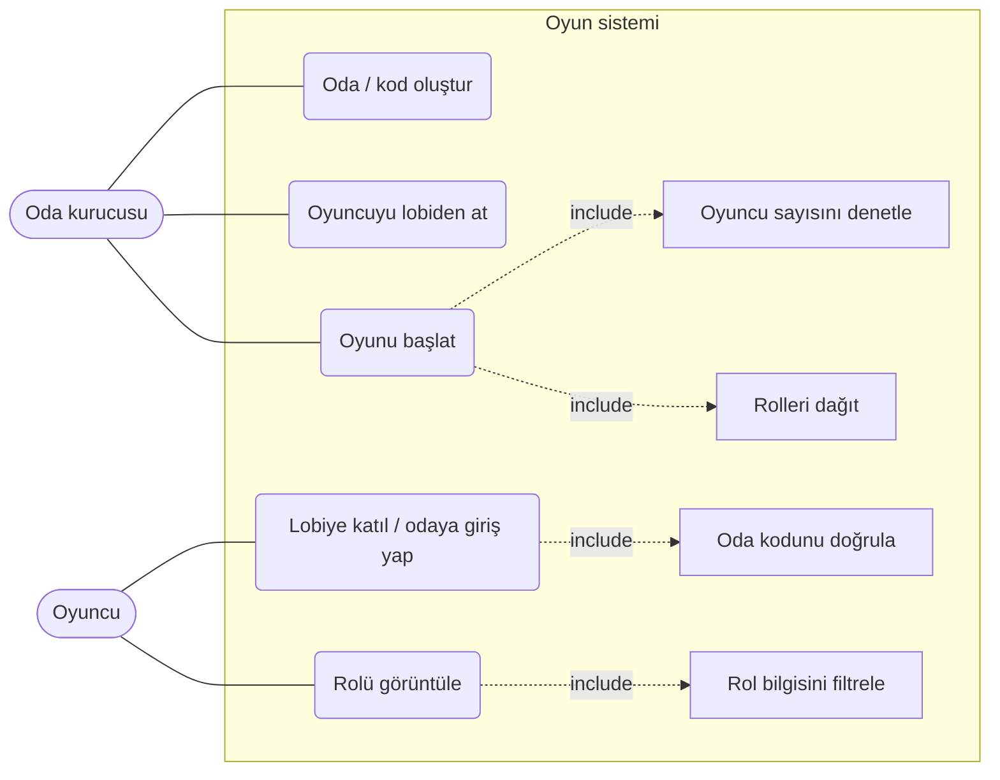
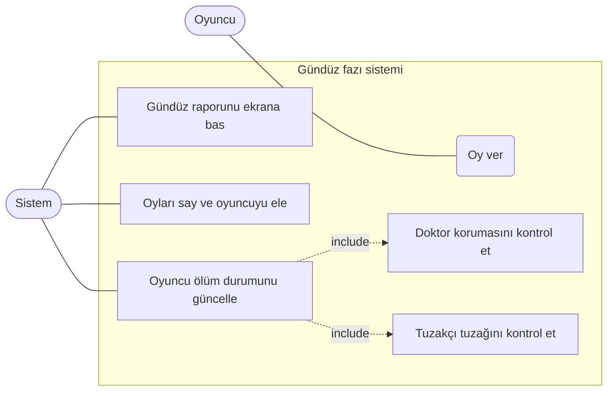
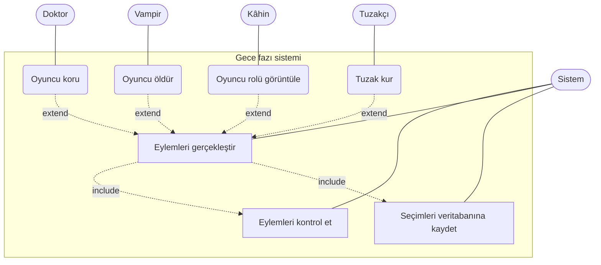

# Vampir Köylü – Gereksinim Belgesi (SRS)

## 1. Giriş

### 1.1 Amaç

Bu belge, Vampir Köylü web oyununun gereksinimlerini tanımlar. Projenin ne yapacağını, nelerin kapsam dışı olduğunu ve teknik olarak zor kısımlarını açıklar.

### 1.2 Proje özeti

Vampir Köylü, 5 ile 12 oyuncunun tarayıcıdan oynadığı bir rol oyunudur. Oyuncular oda koduyla lobiye katılır ve herkese gizlice bir rol verilir. Oyun gece ve gündüz fazlarıyla ilerler. Gece özel roller gizli eylem yapar, gündüz oyuncular oy vererek birini eler. Bir taraf kazanınca oyun biter.

### 1.3 Grup üyeleri

| Ad Soyad      | Sorumluluk                                                   |
| ------------- | ------------------------------------------------------------ |
| Figen Arslan  | Repo, giriş, kapsam dışı, çekirdek problem, birleştirme      |
| Melek Efe     | Kullanıcı hikâyeleri                                         |
| Zeynep Tunç   | İşlevsel gereksinimler                                       |
| Zeynep Çakmak | İşlevsel olmayan gereksinimler, use-case, yapay zekâ günlüğü |

### 1.4 Oyun kuralları

#### 1.4.1 Oda ve oyuncular

- Oyuncu oda açar, sistem oda kodu üretir. Diğer oyuncular bu kodla katılır.
- Odada en az 5, en fazla 12 oyuncu bulunur.
- Oyunu yalnızca oda sahibi başlatır. Oyun başladıktan sonra yeni oyuncu katılamaz.

#### 1.4.2 Roller

| Rol     | Taraf     | Gece yeteneği                                           |
| ------- | --------- | ------------------------------------------------------- |
| Köylü   | Köylüler  | Yok                                                     |
| Vampir  | Vampirler | Kurban seçer. Vampirler birbirini görmez.                |
| Doktor  | Köylüler  | Kendi dahil bir kişiyi korur.                           |
| Kâhin   | Köylüler  | Bir oyuncunun rolünü öğrenir.                           |
| Tuzakçı | Köylüler  | İsteğe bağlı rol (bonus). Bu sürümde uygulanmayacaktır. |

Roller oyun başlarken sunucuda rastgele ve gizli dağıtılır.

| Oyuncu sayısı | Vampir | Doktor | Kâhin | Köylü      |
| ------------- | ------ | ------ | ----- | ---------- |
| 5-7           | 1      | 1      | 1     | geri kalan |
| 8-10          | 2      | 1      | 1     | geri kalan |
| 11-12         | 3      | 1      | 1     | geri kalan |

Vampir sayısı en fazla 3'tür. 8 oyuncudan azsa tam 1 vampir bulunur.

#### 1.4.3 Fazlar ve süreler

| Faz    | Süre           | Açıklama                                                                                         |
| ------ | -------------- | ------------------------------------------------------------------------------------------------ |
| Lobi   | Süresiz        | Oyuncular toplanır, oda sahibi başlatır.                                                         |
| Gece   | 25 sn          | Vampir, doktor ve kâhin eylemini seçer. Vampirlerin kurban seçimi gecenin ilk 15 saniyesindedir. |
| Gündüz | 75 sn          | Gece sonuçları açıklanır, oyuncular tartışır.                                                    |
| Oylama | En fazla 30 sn | Herkes oy kullanınca süre dolmadan biter.                                                        |
| Bitiş  | ,              | Kazanan açıklanır.                                                                               |

Gece, gündüz ve oylama kazanan çıkana kadar sırayla tekrarlanır. Süre dolunca fazı sunucu ilerletir. Uygulamada sohbet yoktur.

#### 1.4.4 Gece

- Vampirlerin hepsinin seçtiği kurban ölür.
- Doktor, kendisi dahil bir oyuncuyu korur. Korunan kişi saldırıya uğrasa da ölmez.
- Doktor kendini 2 gece üst üste koruyamaz ama herhangi bir köylüyü art arda koruyabilir.
- Kâhin bir oyuncunun rolünü öğrenir. Sonucu yalnızca kendisi görür.
- Süre dolana kadar eylem seçilmezse o eylem boş geçer.

#### 1.4.5 Sabah

- Gece sonuçları herkese toplu açıklanır: "Gece X öldü" veya "Gece kimse ölmedi".
- Doktorun birini kurtarıp kurtarmadığı söylenmez.

#### 1.4.6 Oylama

- Her canlı oyuncu bir kez oy kullanır, oyunu değiştiremez.
- Kimse kendine oy veremez.
- Oylamada pas geçilebilir.
- En çok oyu alan oyuncu elenir.
- Eşitlik kuralı: Oylamada eşitlik çıkarsa veya en çok oyu pas alırsa kimse elenmez, oyun geceye geçer.
- Elenen oyuncunun rolü (kâhin dahil) açıklanır.
- Ölü ve elenen oyuncular oy veremez.

#### 1.4.7 Ölü ve elenen oyuncular

- Ölenler oyunu hayalet olarak izleyebilir.
- Hayalet yalnızca herkese açık bilgileri görür: faz, süre, ölenler, açıklanmış roller ve oy sonuçları.
- Hayalet, canlı oyuncuların gizli rollerini göremez.

#### 1.4.8 Kazanma koşulları

Kontrol her gece sonuçlandığında ve her oylamadan sonra yapılır.

- Köylüler kazanır: Tüm vampirler elenince.
- Vampirler kazanır: Canlı vampir sayısı, canlı köylü tarafı oyuncularının (köylü, doktor, kâhin,
tuzakçı) sayısına eşit olunca.
- Oylamada köylü, doktor ve kâhin köylü tarafında sayılır.

#### 1.4.9 Gizlilik kuralı

- Her oyuncu yalnızca kendi rolünü görür.
- Vampir, diğer vampirleri göremez.
- Sunucu yanıtında bu istisna dışında başkasının rolü bulunmaz.

## 2. Kapsam dışı

- Oyun içi sohbet yoktur. Tartışma uygulama dışında yapılır.
- Bot (bilgisayar) oyuncular yoktur.

## 3. Çekirdek problem

### 3.1 Faz durum makinesi

Oyun lobi, gece, gündüz, oylama ve bitiş fazlarından geçer. Her fazın bir süresi vardır ve süre dolunca fazı sunucu ilerletir. Gece 25 saniyedir: ilk 15 saniye seçim, kalan 10 saniye eylemlerin uygulanması içindir. Oylama, herkes oy kullanınca süre dolmadan da biter. İstemciden gelen süre veya faz bilgisine güvenilmez. Aynı faz iki eşzamanlı istekle iki kez ilerletilemez.

### 3.2 Role özel gizli bilgi

Hiçbir oyuncu başkasının rolünü sunucu yanıtından öğrenememelidir. Aynı sunucu adresi her oyuncuya farklı veri döndürür. Vampirler birbirini görmez. Kâhin ek olarak yalnızca sorguladığı oyuncuların rolünü görür. Hayalet yeni gizli bilgi görmez. Sunucu, vampirin başka bir vampiri seçmesini reddetmez, çünkü ret cevabı rolü sızdırır.

### 3.3 Oylama sayımı ve eşitlik kuralı

Oyuncular bir kişiye oy verir veya pas geçer. Oy vermeyen pas sayılır. En çok oyu alan oyuncu elenir. En yüksek oyda eşitlik varsa ya da en çok oyu pas aldıysa kimse elenmez.

### 3.4 Kazanma koşulu denetimi

Her gece çözümünden ve her oylamadan sonra kazanan kontrol edilir. Hayatta vampir kalmazsa köylü takımı, hayattaki vampir sayısı diğer oyuncuların sayısına eşit ya da fazla olursa vampir takımı kazanır.

### 3.5 Gece eylemlerinin sıralı çözümü

Gece eylemleri sunucuda sabit bir sırayla çözülür: tuzakçı, vampir, doktor, kâhin. Tuzağa takılan eylem iptal olur. Sonuçlar sabaha kadar gizli tutulur ve sabah toplu açıklanır.

## 2. Kapsam dışı

- Oyun içi sohbet yoktur. Tartışma oyuncular arasında oyun dışında yapılır.
- Bilgisayar (bot) oyuncular yoktur.
- Ek roller isteğe bağlıdır. Tuzakçı rolü bu sürümde uygulanmayacaktır.

## 3. Çekirdek problem

### 3.1 Faz durum makinesi

Oyun lobi, gece, gündüz, oylama ve bitiş fazlarından geçer. Her fazın bir süresi vardır ve süre dolunca fazı sunucu ilerletir. Tarayıcıdan gelen süre veya faz bilgisine güvenilmez. Oylama fazı, herkes oy kullanınca süre dolmadan da biter. Aynı fazın iki eşzamanlı istekle iki kez ilerletilmemesi gerekir.

### 3.2 Role özel gizli bilgi

Hiçbir oyuncu başkasının rolünü sunucu yanıtından öğrenememelidir. Aynı sunucu adresi her oyuncuya farklı veri döndürür. Vampir yalnızca diğer vampirleri, kâhin ise yalnızca baktığı kişinin rolünü ek olarak görür. Ölü oyuncular (hayaletler) gizli rolleri göremez.

### 3.3 Oylama sayımı ve eşitlik kuralı

Gündüz oyuncular oy verir veya pas geçer. En çok oyu alan oyuncu elenir. Eşit oyda veya en çok oyu pas aldığında kimse elenmez ve oyun geceye geçer. Gece vampir oylamasında eşitlik çıkarsa o gece kimse ölmez.

### 3.4 Kazanma koşulu denetimi

Her gece sonucundan ve her oylamadan sonra kazanan kontrol edilir. Tüm vampirler elenirse köylüler, canlı vampir sayısı canlı köylü tarafının sayısına eşit olursa vampirler kazanır.

## 4. Kullanıcı hikâyeleri

## 4. Kullanıcı hikayeleri

### US-1 · Kayıt, giriş ve çıkış

**Hikaye:** Oyuncu olarak, e-posta ve şifremle kayıt olup giriş ve çıkış yapmak istiyorum, böylece oyunlara kimliğimle katılabilirim.

**İlgili gereksinimler:** FR-1, FR-2

**Kabul kriterleri:**

- [ ] Geçerli e-posta ve şifreyle kayıt oluşturulur; aynı e-posta ikinci kez kullanılamaz
- [ ] Şifre password_hash ile saklanır, düz metin tutulmaz
- [ ] Hatalı girişte anlaşılır hata mesajı gösterilir
- [ ] Başarılı girişte session_regenerate_id çağrılır
- [ ] Çıkış yapılınca oturum sonlandırılır ve korumalı sayfalara erişilemez

### US-2 · Oda koduyla odaya katılma

**Hikaye:** Oyuncu olarak, oda kodunu aratarak ya da filtreleyerek mevcut bir odaya katılmak istiyorum, böylece arkadaşlarımın oyununa dahil olabilirim.

**İlgili gereksinimler:** FR-3 · **İlgili NFR:** NFR-1

**Kabul kriterleri:**

- [ ] Geçerli kodla oyuncu lobiye eklenir ve diğer oyuncular onu lobide görür
- [ ] Oda kodu aratılabilir ve/veya listelenen odalar filtrelenebilir
- [ ] Geçersiz kodda hata mesajı gösterilir
- [ ] 12 oyunculu dolu odaya katılım reddedilir ve uyarı 3 sn içinde gösterilir (NFR-1)
- [ ] Oyun başladıktan sonra odaya katılım yapılamaz

### US-3 · Oyunu başlatma

**Hikaye:** Oda kurucusu olarak, odaya yeterli oyuncu katılınca oyunu başlatmak istiyorum, böylece oyun başlar.

**İlgili gereksinimler:** FR-4 · **İlgili NFR:** NFR-3

**Kabul kriterleri:**

- [ ] Oyun yalnızca oda kurucusunun isteğiyle başlar; başkasının isteği reddedilir (yetki kontrolü)
- [ ] Oyuncu sayısı 5-12 aralığındaysa oyun başlar
- [ ] Oyuncu sayısı 5'ten azsa ya da 12'den fazlaysa başlatma reddedilir ve hata mesajı gösterilir (NFR-3)
- [ ] Başlangıç günlüğe yazılır ve oyun Gece fazına geçer

### US-4 · Rol dağıtımı

**Hikaye:** Oyuncu olarak, oyun başlarken rolümün rastgele atanmasını istiyorum, böylece oyun adil olur.

**İlgili gereksinimler:** FR-5

**Kabul kriterleri:**

- [ ] Roller random_int/shuffle ile her oyunda rastgele dağıtılır
- [ ] Her oyunda 1 doktor ve 1 kâhin vardır; en az Köylü, Vampir, Doktor, Kâhin rolleri kullanılır
- [ ] Ayarlanan sayıda vampir ve (varsa) tuzakçı atanır
- [ ] Tuzakçı eklenirse bir köylünün yerini alır; kalan oyuncular köylü olur

### US-5 · Faz ve süre yönetimi

**Hikaye:** Oyuncu olarak, oyunun hangi fazda olduğunu ve kalan süreyi görmek istiyorum, böylece ne zaman hamle yapacağımı bilirim.

**İlgili gereksinimler:** FR-6 · **İlgili NFR:** NFR-6

**Kabul kriterleri:**

- [ ] Fazlar Lobi → Gece (25 sn) → Gündüz (75 sn) → Oylama (30 sn) → Bitiş sırasıyla ilerler
- [ ] Faz ve kalan süre ekranda görünür ve AJAX polling ile güncellenir
- [ ] Süre dolunca sunucu fazı kendisi ilerletir; istemciden gelen süre bilgisine güvenilmez
- [ ] Erken istek ya da değiştirilmiş istemci süresi fazı erkene alamaz
- [ ] Eş zamanlı birden fazla istek gelse de faz yalnızca bir kez ilerler (PDO transaction, NFR-6)
- [ ] Gündüz fazında uygulama içi sohbet yoktur; tartışma uygulama dışında yapılır
- [ ] Her faz değişimi günlüğe yazılır

### US-6 · Gece eylemleri

**Hikaye:** Vampir, doktor, kâhin ve tuzakçı olarak, gecenin ilk 15 saniyesinde eylemimi seçmek istiyorum, böylece rolümün görevini yapabilirim.

**İlgili gereksinimler:** FR-7, FR-8

**Kabul kriterleri:**

- [ ] Eylem seçimi yalnızca 25 sn'lik Gece fazının ilk 15 saniyesinde kabul edilir ve seçim değiştirilemez (FR-7)
- [ ] Tüm gece eylemleri sunucuda doğrulanır; istemciye güvenilmez (FR-8)
- [ ] Vampir kendini seçemez, başka vampiri seçebilir (vampir kimliği sızmaz); hiç seçim yapılmazsa vampir kurbanı olmaz; vampirler farklı hedef seçerse birden fazla kişi kurban olur
- [ ] Doktor kendisi dahil canlı birini koruyabilir; art arda iki gece kendini koruyamaz
- [ ] Kâhin kendisi hariç canlı birini sorgular; sonuç yalnızca kâhine döner
- [ ] Tuzakçı kendi evine tuzak kuramaz; hedef eve eylem yapan ilk oyuncunun eylemi iptal edilir
- [ ] Gece sonu çözüm sırası: tuzaklar → vampir saldırısı ile doktor koruması → kâhin sorgusu
- [ ] Tuzakçı yalnızca birinin takılıp takılmadığını görür; takılan kişi yalnızca "tuzağa takıldın" bilgisini alır
- [ ] Ölü ve elenen oyuncunun gece eylemi sunucuda reddedilir

### US-7 · Rol gizliliği

**Hikaye:** Oyuncu olarak, rolümü yalnızca benim görmemi istiyorum, böylece diğer oyuncular gizli bilgime ulaşamaz.

**İlgili gereksinimler:** FR-9 · **İlgili NFR:** NFR-7

**Kabul kriterleri:**

- [ ] Her oyuncu yalnızca kendi rolünü görür; vampir diğer vampirlerin kim olduğunu görmez
- [ ] Aynı JSON uç noktası her oyuncuya role göre filtrelenmiş farklı veri döner
- [ ] Kâhin dışındaki hiçbir oyuncunun API yanıtında başkasının rolü bulunmaz (NFR-7)
- [ ] Başka oyuncunun rolü geliştirici araçlarındaki ağ yanıtında da görünmez
- [ ] Gece eylemleri sabah duyurusuna kadar hiçbir oyuncuya gösterilmez

### US-8 · Sabah duyurusu

**Hikaye:** Oyuncu olarak, gece olanları sabah toplu olarak görmek istiyorum, böylece gündüz tartışmasına hazırlanırım.

**İlgili gereksinimler:** FR-10

**Kabul kriterleri:**

- [ ] 75 sn'lik Gündüz fazı başlayınca duyuru gösterilir: "Bu gece X öldü" ya da "Bu gece kimse ölmedi"
- [ ] Doktorun birini kurtarıp kurtarmadığı açıklanmaz
- [ ] Doktorun koruduğu kişi vampir kurbanıysa ölmez, diğer kurbanlar ölür
- [ ] Gece sonucu günlüğe yazılır

### US-9 · Oy verme ve eleme

**Hikaye:** Canlı oyuncu olarak, oylamada bir oyuncuya oy vermek ya da pas geçmek istiyorum, böylece şüpheli birini eleyebilirim.

**İlgili gereksinimler:** FR-11, FR-12 · **İlgili NFR:** NFR-5

**Kabul kriterleri:**

- [ ] 30 sn'lik Oylama fazında yalnızca canlı oyuncular oy verebilir; ölü ve elenenler veremez
- [ ] Oyuncu kendine oy veremez; her oyuncunun bir oy hakkı vardır, 2. ve sonraki oylar reddedilir (NFR-5)
- [ ] Herkes oy kullanırsa oylama süre dolmadan biter; süre dolana kadar oy vermeyen pas sayılır
- [ ] En çok oyu alan oyuncu elenir
- [ ] En yüksek oyda eşitlik varsa ya da en çok oy "pas" ise kimse elenmez (FR-12)
- [ ] Oylama sonucu ve eleme günlüğe yazılır

### US-10 · Rol açıklama kuralı

**Hikaye:** Oyuncu olarak, ölen oyuncuların rollerinin ne zaman açıklandığını bilmek istiyorum, böylece oyun kuralları net olur.

**İlgili gereksinimler:** FR-13

**Kabul kriterleri:**

- [ ] Oylamayla elenen oyuncunun rolü herkese açıklanır
- [ ] Gece ölen oyuncunun rolü açıklanmaz
- [ ] İstisna: kâhin gece ölse de oylamayla elense de rolü herkese açıklanır
- [ ] Açıklanan roller herkese görünür; diğer gizli roller görünmez

### US-11 · Kazanma koşulunu denetleme

**Hikaye:** Oyuncu olarak, oyunun doğru anda ve doğru kazananla bitmesini istiyorum, böylece sonuca güvenebilirim.

**İlgili gereksinimler:** FR-14 · **İlgili NFR:** NFR-4

**Kabul kriterleri:**

- [ ] Kontrol her gece çözümünden ve her oylamadan sonra yapılır
- [ ] Hayatta vampir kalmayınca köylü takımı kazanır (kâhin, doktor, tuzakçı ve köylü köylü tarafındadır)
- [ ] Hayattaki vampir sayısı, hayattaki vampir olmayan oyuncu sayısına eşit ya da fazla olunca vampir takımı kazanır
- [ ] Kazanan varsa oyun Bitiş fazına geçer; yoksa sıradaki faza devam eder
- [ ] Kazanma hesabı sınır durumları dahil PHPUnit testleriyle doğrulanır (NFR-4)

### US-12 · Oyun sonu raporu

**Hikaye:** Oyuncu olarak, oyun bitince kazanan takımı ve oyun özetini görmek istiyorum, böylece oyunun nasıl bittiğini değerlendirebilirim.

**İlgili gereksinimler:** FR-15

**Kabul kriterleri:**

- [ ] Rapor ekranında kazanan takım görünür
- [ ] Oyun bitince tüm oyuncuların rolleri açıklanır
- [ ] Olay özeti gece eylemleri dahil günlükten oluşturulur
- [ ] Oyunun bittiği doğrulanmadan rapor gösterilmez

### US-13 · Oda kurma

**Hikaye:** Oda kurucusu olarak, yeni bir oda kurup oda kodunu almak istiyorum, böylece arkadaşlarımı odaya davet edebilirim.

**İlgili gereksinimler:** FR-16 · **İlgili NFR:** NFR-2

**Kabul kriterleri:**

- [ ] Oda kurulunca en az 6 karakterli benzersiz bir oda kodu üretilir ve kurucuya gösterilir (NFR-2)
- [ ] Kurucu otomatik olarak odanın ilk oyuncusu olur
- [ ] Oda Lobi durumunda açılır

### US-14 · Rol sayılarını ayarlama

**Hikaye:** Oda kurucusu olarak, vampir ve tuzakçı sayısını oyuncu sayısına göre ayarlamak istiyorum, böylece oyunun zorluğunu belirleyebilirim.

**İlgili gereksinimler:** FR-17

**Kabul kriterleri:**

- [ ] 5-7 oyunculu odada vampir sayısı yalnızca 1 olabilir
- [ ] 8-12 oyunculu odada vampir sayısı 1-3 arasında seçilebilir
- [ ] Tuzakçı sayısı (1 ya da 2) yalnızca 8 ve üzeri oyuncuda seçilebilir
- [ ] Yalnızca oda kurucusu bu ayarları değiştirebilir (yetki kontrolü)

### US-15 · Hayalet olarak izleme

**Hikaye:** Ölen ya da elenen oyuncu olarak, oyunu hayalet olarak izlemek istiyorum, böylece oyuna katılamasam da nasıl bittiğini görebilirim.

**İlgili gereksinimler:** FR-18

**Kabul kriterleri:**

- [ ] Hayalet oyunun faz, duyuru ve günlüğünü izleyebilir
- [ ] Hayalet oy veremez ve gece eylemi yapamaz (sunucu reddeder)
- [ ] Hayalet ölmeden önce öğrendiklerini görür, yeni gizli bilgi görmez

### US-16 · Oyun günlüğünü izleme

**Hikaye:** Oyuncu olarak, oyun günlüğünden olanları görmek istiyorum, böylece kaçırdığım olayları anlayıp oyunu takip edebilirim.

**İlgili gereksinimler:** FR-19

**Kabul kriterleri:**

- [ ] Günlükte başlangıç, faz değişimleri, gece sonucu, oylama sonucu, eleme ve bitiş kayıtları vardır
- [ ] Gizli gece eylemleri oyun bitene kadar günlükte görünmez
- [ ] Günlük canlı oyuncular ve hayaletler tarafından görülebilir

## 5. İşlevsel gereksinimler (FR)

| :--- | :--- | :--- |
| FR-1 | Sistem, kullanıcıların e-posta ve şifreyle kayıt olmasını sağlamalı. | US-1 |
| FR-2 | Sistem, kayıtlı kullanıcıların giriş ve çıkış işlemlerini yapabilmesini sağlamalı. | US-1 |
| FR-3 | Sistem, oyuncuların oda kodunu aratarak veya filtreleyerek mevcut bir odaya katılabilmesini sağlamalı. | US-2 |
| FR-4 | Sistem, odaya en az 5, en fazla 12 oyuncu katıldığında yalnızca oda kurucusunun oyunu başlatabilmesini sağlamalı; bu aralığın dışında başlatmayı reddetmeli. | US-3 |
| FR-5 | Sistem, oyun başlarken oyunculara en az 4 farklı rolü (Köylü, Vampir, Doktor, Kâhin ve isteğe bağlı Tuzakçı) rastgele dağıtabilmeli. | US-4 |
| FR-6 | Sistem, Lobi, Gece, Gündüz, Oylama ve Bitiş fazları arasındaki geçişleri sunucu süresini baz alarak ilerletmeli ve aynı fazı iki kez işletmemeli. | US-5 |
| FR-7 | Sistem, 25 saniyelik Gece fazının ilk 15 saniyesinde oyuncuların aksiyon seçimlerini almalı ve yapılan seçimin değiştirilmesini engellemeli. | US-6 |
| FR-8 | Sistem, gece eylemlerini (Tuzakçı, Vampir, Doktor, Kâhin) ve oyuncuların oylarını istemciye güvenmeden doğrudan sunucu tarafında doğrulamalı ve çözmeli. | US-6 |
| FR-9 | Sistem, her oyuncuya yalnızca kendi rolünü göstermeli; başka bir oyuncunun gizli rolü (vampirlerin kimliği dahil) hiçbir yanıtta yer almamalı. | US-7 |
| FR-10 | Sistem, 75 saniyelik Gündüz fazı başladığında, gece ölen oyuncuları veya "kimse ölmedi" bilgisini sabah duyurusu olarak göstermeli. | US-8 |
| FR-11 | Sistem, 30 saniyelik Oylama fazında yalnızca canlı oyuncuların birbirine oy vermesini veya pas geçmesini sağlamalı; her oyuncu yalnızca bir oy kullanabilmeli. | US-9 |
| FR-12 | Sistem, oylamada eşitlik çıkması veya en çok oyu "pas" seçeneğinin alması durumunda o gün kimseyi elememeli. | US-9 |
| FR-13 | Sistem, oylamayla elenen oyuncunun rolünü herkese açıklarken, kâhin sorguları ve açıklanmış roller hariç gece ölen oyuncuların rollerini gizli tutmalı. | US-10 |
| FR-14 | Sistem, her gece çözümünden ve her oylamadan sonra kazanma koşullarını kontrol ederek oyunun bitip bitmediğine karar vermeli. | US-11 |
| FR-15 | Sistem, oyun sona erdiğinde kazanan takımı, tüm oyuncuların rollerini ve olay özetini gösteren bir rapor ekranı sunabilmeli. | US-12 |
| FR-16 | Sistem, giriş yapmış kullanıcıya benzersiz kodlu yeni bir oda (lobi) kurma imkânı vermeli ve kullanıcıyı oda kurucusu yapmalı. | US-13 |
| FR-17 | Sistem, oda kurucusunun vampir ve tuzakçı sayısını oyuncu sayısına göre sınırlı seçeneklerle ayarlamasını sağlamalı. | US-14 |
| FR-18 | Sistem, ölen ve elenen oyuncuyu hayalet yapmalı: oyunu izleyebilir, oy veremez, eylem yapamaz, yeni gizli bilgi görmez. | US-15 |
| FR-19 | Sistem, oyun günlüğüne başlangıcı, faz değişimlerini, gece sonucunu, oylama sonucunu, elemeyi ve bitişi yazmalı; gizli gece eylemlerini oyun bitene kadar göstermemeli. | US-16 |

## 6. İşlevsel olmayan gereksinimler (NFR)

| NFR-1 | 12 oyunculu dolu bir odaya katılmaya çalışan oyuncuya, reddedilme uyarısı en geç 3 saniye içinde ekranda gösterilmelidir. | Dolu odaya katılım isteği atılır, uyarının görünme süresi ölçülür. | US-2 |
| NFR-2 | Oda kodları en az 6 karakter uzunluğunda olmalı ve 1000 oda oluşturulduğunda çakışan kod sayısı 0 olmalıdır. | 1000 kod üretilip tekrar edenler sayılır. | US-13 |
| NFR-3 | Oyuncu sayısı alt sınırın (5) altındayken başlatma isteklerinin %100'ü reddedilmelidir. | 1-4 oyunculu odada başlatma isteği atılır, reddedilme oranı ölçülür. | US-3 |
| NFR-4 | Çekirdek problem için en az 5 PHPUnit testi bulunmalı ve tümü başarıyla geçmelidir. | phpunit çalıştırılır, başarısız test sayısı 0 olmalıdır. | US-11 |
| NFR-5 | Aynı oylamada aynı oyuncudan gelen 2. ve sonraki oy girişimlerinin %100'ü reddedilmelidir; votes tablosunda oyuncu başına oy sayısı 1'i geçmemelidir. | Aynı oyuncudan birden fazla oy isteği atılır, votes tablosu sorgulanır. | US-9 |
| NFR-6 | Aynı faza aynı anda gelen birden fazla ilerletme isteğinden yalnızca 1'i fazı ilerletmelidir; faz geçiş sayısı faz başına 1'i geçmemelidir. | Eş zamanlı 10 istek gönderilir, günlükteki faz geçişleri sayılır. | US-5 |
| NFR-7 | Kâhin dışındaki bir oyuncunun API yanıtlarında başka bir oyuncunun gizli rolü bulunmamalıdır; sızan rol sayısı 0 olmalıdır. | Her rolle giriş yapılıp tüm uç nokta yanıtları taranır.

## 7. Kullanım senaryoları (use-case)

# USE CASE: Oyuna Katılım ve Rol Dağılımı

## Diyagram

# USE CASE: Gündüz Fazı ve Sonuç Kontrolü

## Diyagram

# USE CASE: Gece Fazı Eylemleri

## Diyagram

## 8. İzlenebilirlik tablosu

# Gereksinim–Test İzlenebilirlik Tablosu

Tür: **B** = PHPUnit birim testi, **E** = entegrasyon/HTTP testi, **M** = manuel/komut ile ölçüm. Durum: Bekliyor / Geçti / Kaldı.

## 1. Kapsama tablosu (hangi gereksinim hangi testle doğrulanıyor)

| Gereksinim | Test no                |
| :--------- | :--------------------- |
| FR-1       | T-01, T-02             |
| FR-2       | T-03                   |
| FR-3       | T-04, T-05, T-06       |
| FR-4       | T-07, T-08             |
| FR-5       | T-09                   |
| FR-6       | T-10, T-11, T-12       |
| FR-7       | T-13                   |
| FR-8       | T-14, T-15, T-16, T-17 |
| FR-9       | T-18, T-19             |
| FR-10      | T-20                   |
| FR-11      | T-21, T-22, T-23       |
| FR-12      | T-24                   |
| FR-13      | T-25                   |
| FR-14      | T-26, T-27             |
| FR-15      | T-28                   |
| FR-16      | T-29                   |
| FR-17      | T-30                   |
| FR-18      | T-31                   |
| FR-19      | T-32                   |
| NFR-1      | T-05                   |
| NFR-2      | T-29                   |
| NFR-3      | T-07                   |
| NFR-4      | T-33 (tüm B testleri)  |
| NFR-5      | T-22                   |
| NFR-6      | T-12                   |
| NFR-7      | T-19                   |

## 2. Test ayrıntıları

| Test no | Gereksinim   | Test (sınıf::metot)                                 | Tür | Senaryo                                                                                  | Beklenen sonuç                                                                                            | Durum    |
| :------ | :----------- | :-------------------------------------------------- | :-- | :--------------------------------------------------------------------------------------- | :-------------------------------------------------------------------------------------------------------- | :------- |
| T-01    | FR-1         | AuthServiceTest::testRegisterHashesPassword         | B   | Geçerli e-posta ve şifreyle kayıt                                                        | Kullanıcı oluşur; kayıtlı şifre düz metin değil, `password_hash` çıktısıdır                               | Bekliyor |
| T-02    | FR-1         | AuthServiceTest::testDuplicateEmailRejected         | B   | Aynı e-postayla ikinci kayıt                                                             | Kayıt reddedilir, anlaşılır hata döner                                                                    | Bekliyor |
| T-03    | FR-2         | AuthControllerTest::testLoginLogout                 | E   | Hatalı şifre; doğru şifre; çıkış                                                         | Hatalı şifre reddedilir; girişte `session_regenerate_id` çağrılır; çıkıştan sonra korumalı sayfa açılmaz  | Bekliyor |
| T-04    | FR-3         | RoomServiceTest::testJoinWithCode                   | B   | Geçerli ve geçersiz oda koduyla katılım                                                  | Geçerli kodda oyuncu eklenir; geçersizde hata                                                             | Bekliyor |
| T-05    | FR-3, NFR-1  | RoomControllerTest::testFullRoomRejected            | E   | 12 oyunculu odaya 13. oyuncu katılmayı dener                                             | Katılım reddedilir; uyarı en geç 3 sn içinde gösterilir (süre ölçülür)                                    | Bekliyor |
| T-06    | FR-3         | RoomServiceTest::testJoinAfterStartRejected         | B   | Oyun başladıktan sonra katılım                                                           | Reddedilir                                                                                                | Bekliyor |
| T-07    | FR-4, NFR-3  | GameStartServiceTest::testStartOutsideRangeRejected | B   | 1, 2, 3, 4 ve 13 oyuncuyla başlatma                                                      | Başlatma isteklerinin %100'ü reddedilir                                                                   | Bekliyor |
| T-08    | FR-4         | GameStartServiceTest::testStartByHostOnly           | B   | 5 ve 12 oyuncuyla kurucu başlatır; kurucu olmayan başlatmayı dener                       | Kurucu başlatabilir; diğeri yetki hatası alır                                                             | Bekliyor |
| T-09    | FR-5         | RoleAssignmentServiceTest::testDistribution         | B   | 5-12 oyuncu için rol dağıtımı (tuzakçılı ve tuzaksız)                                    | 1 doktor, 1 kâhin, doğru sayıda vampir; en az 4 farklı rol; tuzakçı bir köylünün yerini alır              | Bekliyor |
| T-10    | FR-6         | PhaseServiceTest::testPhaseOrderAndDurations        | B   | Bir oyunun fazları ilerletilir                                                           | Sıra Lobi → Gece (25 sn) → Gündüz (75 sn) → Oylama (30 sn) → Gece/Bitiş                                   | Bekliyor |
| T-11    | FR-6         | PhaseServiceTest::testServerTimeOnly                | B   | Süre dolmadan ve istemci "süre doldu" diyerek ilerletme isteği                           | Erken ilerletme reddedilir; süre yalnızca sunucu saatine göre hesaplanır                                  | Bekliyor |
| T-12    | FR-6, NFR-6  | PhaseControllerTest::testConcurrentAdvance          | E   | Aynı faza 10 eş zamanlı ilerletme isteği                                                 | Faz yalnızca 1 kez ilerler; günlükte tek faz geçişi vardır                                                | Bekliyor |
| T-13    | FR-7         | NightActionServiceTest::testSelectionWindow         | B   | Gecenin 10. sn'sinde, 16. sn'sinde seçim; seçimi değiştirme                              | 10. sn kabul; 16. sn reddedilir; değiştirme reddedilir                                                    | Bekliyor |
| T-14    | FR-8         | NightActionServiceTest::testVampireRules            | B   | Vampir kendini seçer; başka vampiri seçer; seçim yapmaz; iki vampir farklı hedef seçer   | Kendini seçme reddedilir; vampiri seçme reddedilmez; seçimsiz gecede kurban yok; iki hedef de kurban olur | Bekliyor |
| T-15    | FR-8         | NightResolverTest::testDoctorProtection             | B   | Doktor kurbanı korur; kendini art arda iki gece korur                                    | Korunan kurban ölmez, diğer kurbanlar ölür; art arda kendini koruma reddedilir                            | Bekliyor |
| T-16    | FR-8         | NightResolverTest::testSeerAndTrapper               | B   | Kâhin kendini sorgular; tuzakçı kendi evine kurar; iki kişi tuzaklı eve gider            | Kâhin kendini seçemez; tuzakçı kendi evine kuramaz; yalnızca ilk gelen takılır, eylemi iptal olur         | Bekliyor |
| T-17    | FR-8         | NightResolverTest::testResolutionOrder              | B   | Tuzak, saldırı, koruma ve sorgu aynı gece; ölü oyuncu eylem gönderir                     | Sıra tuzak → vampir/doktor → kâhin uygulanır; ölü oyuncunun eylemi reddedilir                             | Bekliyor |
| T-18    | FR-9         | RoleVisibilityFilterTest::testOwnRoleOnly           | B   | Her rol için oyun durumu JSON'u üretilir                                                 | Herkes yalnızca kendi rolünü görür; vampir diğer vampirleri görmez; kâhin sorguladığını görür             | Bekliyor |
| T-19    | FR-9, NFR-7  | RoleLeakTest::testNoRoleLeakInAnyEndpoint           | E   | Her rolle giriş yapılıp tüm uç nokta yanıtları taranır                                   | Başkasının gizli rolü (kâhin sorguları ve açıklanan roller hariç) yanıtlarda 0 kez geçer                  | Bekliyor |
| T-20    | FR-10        | MorningAnnouncementTest::testAnnouncementText       | B   | Gece biri ölür; kimse ölmez; doktor kurtarır                                             | "Bu gece X öldü" / "Bu gece kimse ölmedi"; doktorun kurtardığı bilgisi açıklanmaz                         | Bekliyor |
| T-21    | FR-11        | VoteServiceTest::testVoteEligibility                | B   | Ölü oyuncu oy verir; oyuncu kendine oy verir; oyuncu pas geçer                           | Ölü ve kendine oy reddedilir; pas kabul edilir                                                            | Bekliyor |
| T-22    | FR-11, NFR-5 | VoteControllerTest::testSingleVote                  | E   | Aynı oyuncudan 5 oy isteği                                                               | 4'ü reddedilir; `votes` tablosunda oyuncu başına 1 kayıt kalır                                            | Bekliyor |
| T-23    | FR-11        | VoteServiceTest::testTimeoutAndEarlyFinish          | B   | Herkes oy kullanır; süre dolar ve bazıları oy vermemiştir                                | Herkes kullanınca oylama erken biter; vermeyenler pas sayılır                                             | Bekliyor |
| T-24    | FR-12        | VoteServiceTest::testTallyAndTie                    | B   | Eşitlik; en çok oy "pas"; tek en çok oy alan                                             | Eşitlikte ve pasta kimse elenmez; tek en çok oyu alan elenir                                              | Bekliyor |
| T-25    | FR-13        | RoleRevealTest::testRevealRules                     | B   | Oylamayla elenme; gece ölüm; kâhin ölümü (gece ve oylama)                                | Elenenin rolü açıklanır; gece ölenin açıklanmaz; kâhin istisnası uygulanır                                | Bekliyor |
| T-26    | FR-14, NFR-4 | WinConditionServiceTest::testWinConditions          | B   | 0 vampir; vampir ≥ diğerleri; hiçbiri; tuzakçı hayatta                                   | Köylü kazanır; vampir kazanır; oyun devam eder; tuzakçı köylü tarafında sayılır                           | Bekliyor |
| T-27    | FR-14        | GameFlowTest::testCheckAfterNightAndVote            | B   | Gece çözümü sonrası ve oylama sonrası kazanan olur                                       | Her iki durumda oyun Bitiş fazına geçer                                                                   | Bekliyor |
| T-28    | FR-15        | ReportControllerTest::testReport                    | E   | Oyun bitmeden ve bittikten sonra rapor istenir                                           | Bitmeden gösterilmez; bitince kazanan takım, tüm roller, olay özeti görünür                               | Bekliyor |
| T-29    | FR-16, NFR-2 | RoomServiceTest::testRoomCodeUniqueness             | B   | 1000 oda oluştur                                                                         | Kodlar ≥6 karakter; çakışan kod 0; kurucu odanın ilk oyuncusu                                             | Bekliyor |
| T-30    | FR-17        | RoomSettingsServiceTest::testRoleCountLimits        | B   | 5-7 ve 8-12 oyuncuda vampir/tuzakçı sayısı seç; kurucu olmayan değiştirir                | 5-7'de vampir 1; 8-12'de 1-3; tuzakçı 2 yalnızca ≥8; kurucu dışı reddedilir                               | Bekliyor |
| T-31    | FR-18        | GhostPolicyTest::testGhostRestrictions              | B   | Ölü oyuncu oy ve eylem dener; durumu izler                                               | Oy ve eylem reddedilir; yeni gizli bilgi görmez                                                           | Bekliyor |
| T-32    | FR-19        | GameLogServiceTest::testLogEntriesAndSecrecy        | B   | Oyun başlar, fazlar geçer, gece/oylama biter; oyun sürerken ve bittiğinde günlük istenir | Olaylar yazılır; gizli gece eylemleri oyun bitene kadar görünmez                                          | Bekliyor |
| T-33    | NFR-4        | — (komut)                                           | M   | `vendor/bin/phpunit` çalıştır                                                            | Başarısız test sayısı 0; çekirdek problem için B türündeki test sayısı hedefin üzerinde                   | Bekliyor |
