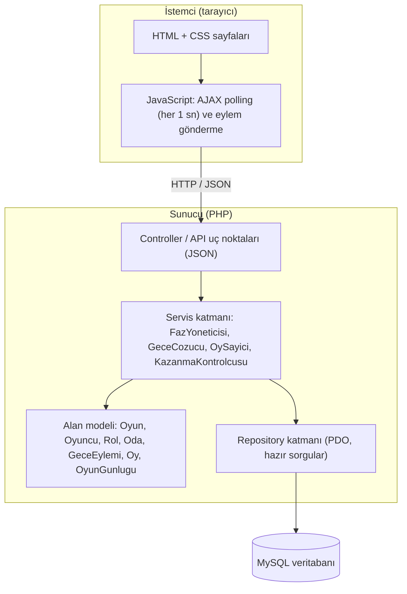
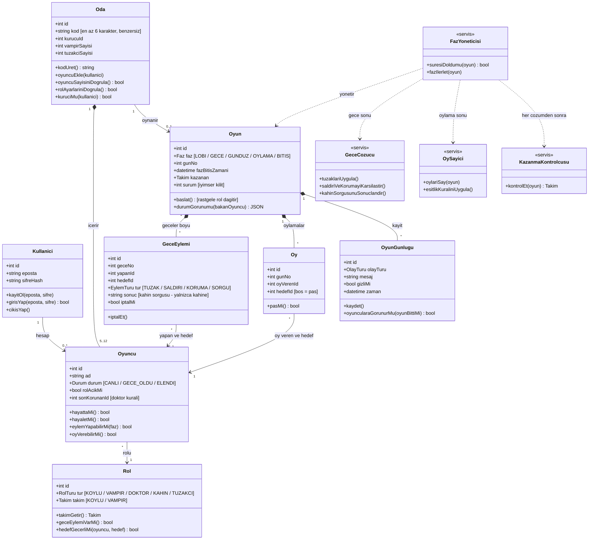
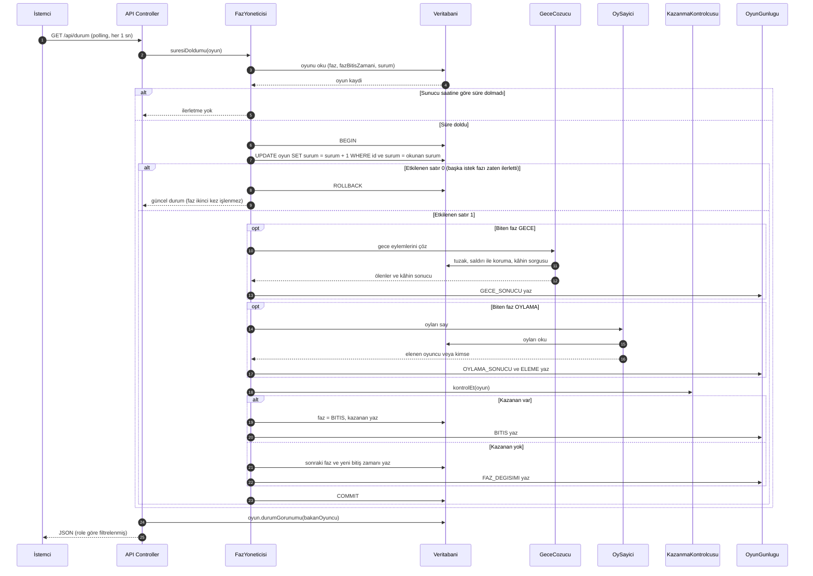
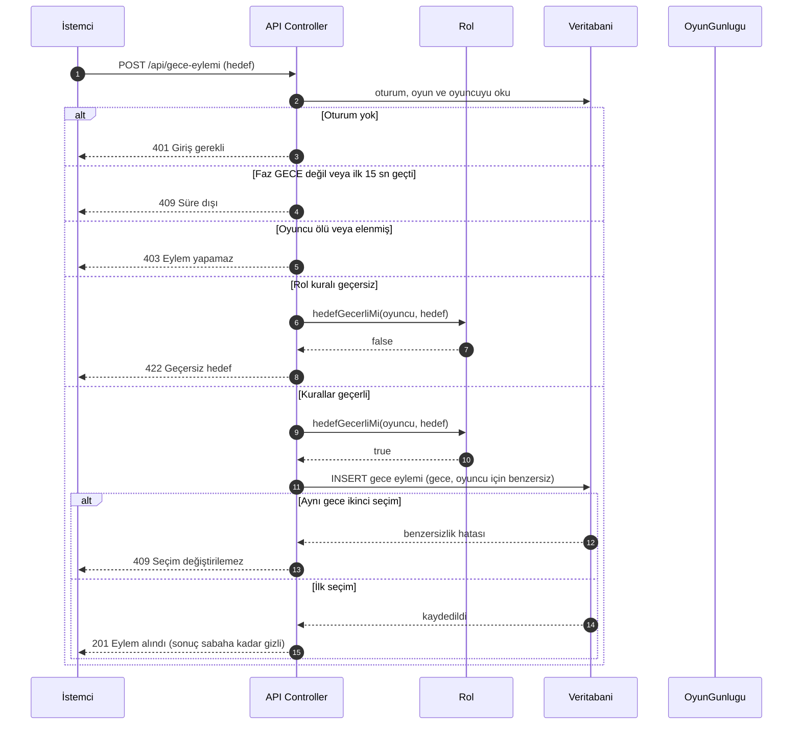
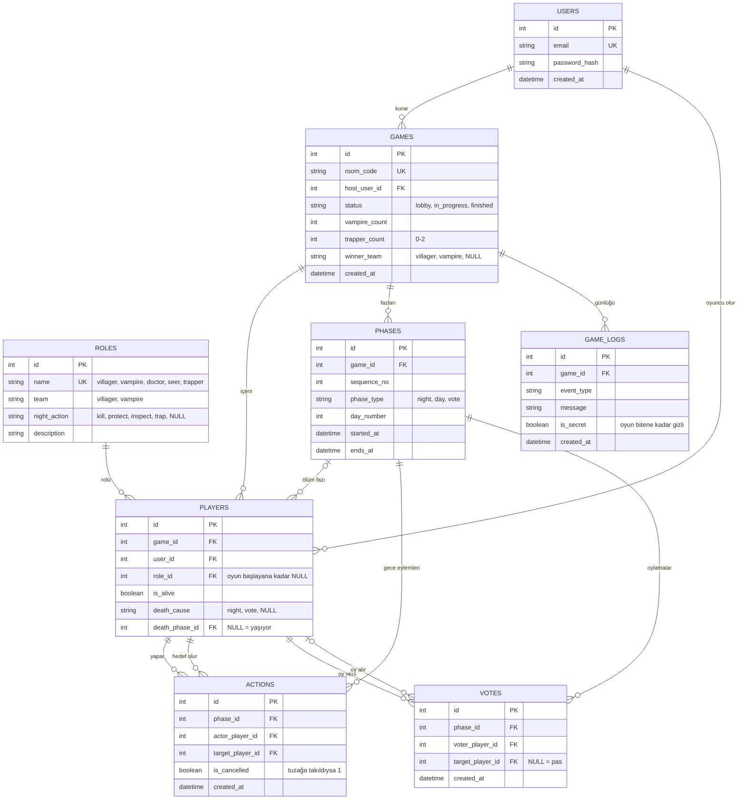
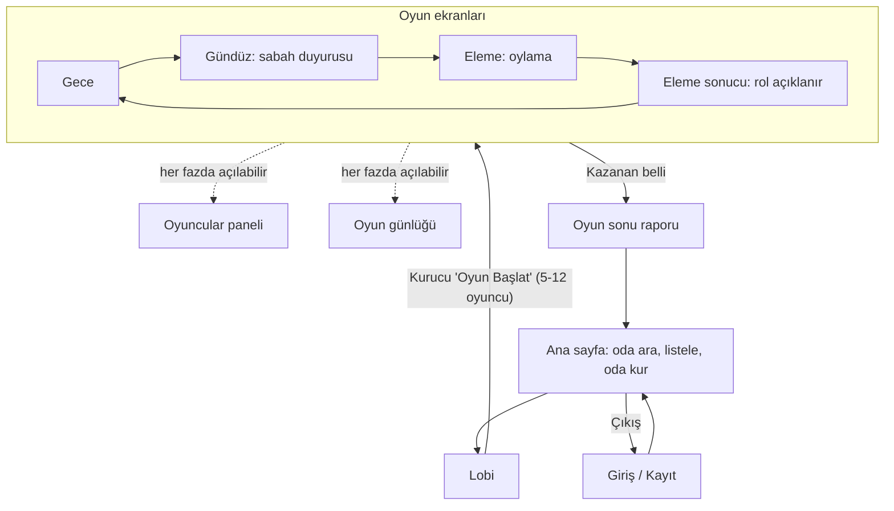

# Vampir Köylü – Tasarım Belgesi

Çok oyunculu, sunucu tabanlı Vampir Köylü (Mafya) oyunu. 5-12 oyuncu, roller Köylü, Vampir, Doktor, Kâhin ve isteğe bağlı Tuzakçı. Fazlar: Lobi → Gece (25 sn) → Gündüz (75 sn) → Oylama (30 sn) → Bitiş. Faz ilerletme sunucudadır, gizli bilgi role göre filtrelenir, istemci AJAX polling ile güncellenir. Kapsam dışı: oyun içi sohbet, botlar.

**İçindekiler:** 1 Mimari · 2 Sınıf diyagramı · 3 Sıralama diyagramı · 4 ER diyagramı · 5 Tasarım desenleri · 6 Arayüz · 7 Riskler · 8 Plan

> FR-x / NFR-x / US-x numaraları kullanıcı hikayeleri ve gereksinimler belgesindeki (FR/NFR eşleşmeli) numaralara karşılık gelir.

---

## 1. Mimari

### 1.1 Katman şeması



| Katman | Sorumluluk | Kural |
| :--- | :--- | :--- |
| İstemci | Faz, kalan süre ve oyuncuya özel veriyi gösterir; eylem ve oy gönderir | Süreye ve role güvenmez; yalnızca sunucudan geleni gösterir |
| Controller | Oturumu ve yetkiyi kontrol eder, girdiyi doğrular, servisi çağırır | İş kuralı içermez |
| Servis | Faz ilerletme, gece çözümü, oy sayımı, kazanma kontrolü | Tüm oyun kuralları burada; PDO transaction ile çalışır |
| Alan modeli | Oyun nesneleri ve kendi kuralları (hedef geçerli mi, oy verebilir mi) | Veritabanını bilmez |
| Repository | SQL sorguları (PDO prepared statement) | Katmanlar arası tek veri erişim noktası |

### 1.2 Klasör yapısı

```text
vampir-koylu/
├── docs/
│   └── tasarim.md              # bu belge
├── public/                     # web kökü
│   ├── index.php               # yönlendirme (front controller)
│   ├── api/                    # JSON uç noktaları: durum, gece-eylemi, oy, faz
│   └── assets/
│       ├── css/
│       └── js/                 # polling.js, oyun.js
├── src/
│   ├── Controller/             # AuthController, OdaController, OyunController
│   ├── Service/                # FazYoneticisi, GeceCozucu, OySayici, KazanmaKontrolcusu
│   ├── Model/                  # Kullanici, Oda, Oyuncu, Rol, Oyun, GeceEylemi, Oy, OyunGunlugu
│   ├── Repository/             # OyunRepository, OyuncuRepository ...
│   └── Core/                   # Database (PDO), Session, Router
├── templates/                  # PHP görünüm dosyaları
├── database/
│   └── schema.sql
└── tests/                      # PHPUnit: KazanmaKontrolcusuTest, OySayiciTest ...
```

---

## 2. Sınıf diyagramı

12 sınıf. Sabit listeler (Faz, Takım, Durum, Eylem Türü, Olay Türü) ayrı sınıf olarak çizilmedi, alan tipi olarak gösterildi; değerleri 2.2'de.

### 2.1 Diyagram



### 2.2 Sınıf özeti

| # | Sınıf | Sorumluluk | İlgili FR / NFR |
| :-- | :--- | :--- | :--- |
| 1 | Kullanıcı | Kayıt, giriş, çıkış | FR-1, FR-2 |
| 2 | Oda | Oda kodu, kurucu, 5-12 oyuncu ve vampir/tuzakçı sayısı doğrulaması | FR-3, FR-4, FR-16, FR-17, NFR-1, NFR-2, NFR-3 |
| 3 | Oyuncu | Canlı/ölü/elenmiş durumu, hayalet modu, doktorun son korunanı | FR-18 |
| 4 | Rol | Rol türü, takım, gece eylemi ve hedef geçerliliği | FR-5, FR-8 |
| 5 | Oyun | Faz, gün, bitiş zamanı, kazanan; rol dağıtımı ve role göre filtrelenmiş görünüm | FR-5, FR-6, FR-9, NFR-6, NFR-7 |
| 6 | GeceEylemi | Gece seçimleri, iptal durumu, kâhin sorgu sonucu | FR-7, FR-8 |
| 7 | Oy | Oylama ve pas (oyuncu başına tek oy) | FR-11, FR-12, NFR-5 |
| 8 | OyunGünlüğü | Olay kaydı, gizli kayıtların oyun bitene kadar saklanması | FR-19 |
| 9 | FazYöneticisi | Süre kontrolü ve fazı yalnızca bir kez ilerletme (PDO transaction) | FR-6, NFR-6 |
| 10 | GeceÇözücü | Tuzaklar → saldırı/koruma → kâhin sorgusu sırası | FR-8, FR-10 |
| 11 | OySayıcı | Oy sayımı, eşitlik ve pas kuralı, rol açıklama | FR-12, FR-13 |
| 12 | KazanmaKontrolcüsü | Her çözümden sonra kazanma koşulu (PHPUnit ile test) | FR-14, FR-15, NFR-4 |

**Sabit liste değerleri**

- **Faz:** LOBİ → GECE (25 sn) → GÜNDÜZ (75 sn) → OYLAMA (30 sn) → BİTİŞ
- **Takım:** KÖYLÜ, VAMPİR
- **Rol türü:** KÖYLÜ, VAMPİR, DOKTOR, KÂHİN, TUZAKÇI
- **Oyuncu durumu:** CANLI, GECE_ÖLDÜ, ELENDİ
- **Eylem türü:** TUZAK, SALDIRI, KORUMA, SORGU
- **Olay türü:** BAŞLANGIÇ, FAZ_DEĞİŞİMİ, GECE_SONUCU, OYLAMA_SONUCU, ELEME, GECE_EYLEMİ, BİTİŞ

---

## 3. Sıralama diyagramı

Çekirdek problem: **sunucunun fazı doğru anda, yalnızca bir kez ilerletmesi** ve **oyuncu eylemlerinin sunucuda doğrulanması**. İki akış gösterilir, ikisinde de hata dalı vardır.

### 3.1 Faz ilerletme (polling ile tetiklenir)



### 3.2 Gece eylemi gönderme



---

## 4. ER diyagramı
# ER Diyagramı



## 3NF Gerekçesi

Oyun durumunu (faz, süre, ölü/diri) tek bir yerde tutmak yerine `games`, `players` ve `phases` olarak ayırdık; böylece faz geçişleri `phases`'e eklenen satırlarla yapılır ve `UNIQUE(game_id, sequence_no)` kısıtı faz geçişinin iki kez tetiklenmesini veritabanı seviyesinde engeller. Gizli rol tek bir sütunda (`players.role_id`) tutulur ve rol sızıntısı, sunucunun yanıtı role göre filtrelemesiyle önlenir. Oylar ve gece eylemleri ayrı tablolardadır; çünkü oy herkes için, eylem yalnızca rolü olanlar için vardır ve alanları farklıdır. Veri tekrarını önlemek için kullanıcı bilgisi `users`'ta, rol bilgisi `roles`'ta, oyun bilgisi `games`'te tutulur; diğer tablolar yalnızca `id` ile bunlara bağlanır ve böylece 3NF sağlanır.


## 5. Tasarım desenleri

### 5.1 State (Durum) – Oyun fazları

- **Nerede:** `Oyun.faz` ve `FazYoneticisi`. Her faz (Lobi, Gece, Gündüz, Oylama, Bitiş) PHP'de `FazDurumu` arayüzünü gerçekleyen bir sınıftır: süresini, izin verdiği eylemleri ve bir sonraki fazı bilir.
- **Gerekçe:** Faz sırası sabit, ancak süre (25/75/30 sn) ve izinli eylem faza göre değişir. `if/switch` zinciri yerine her faz kendi kuralını taşır. Böylece "gece eylemi yalnızca Gece fazında kabul edilir" (FR-7) ve "oy yalnızca Oylama fazında verilir" (FR-11) kuralları tek yerde, faza özel sınıfta durur.
- **Kazanç:** Yeni faz eklemek tek sınıf eklemektir. Faz geçiş sırası `FazYoneticisi` içinde dağınık koşullara dönüşmez.
- **Not:** Bu desen 12 sınıflık diyagramı değiştirmez; `FazYoneticisi`'nin iç yapısıdır.

### 5.2 Strategy (Strateji) – Rol kuralları

- **Nerede:** `Rol.hedefGecerliMi()` ve gece eylemi doğrulaması. Her rol türü için bir `RolKurali` stratejisi vardır (VampirKurali, DoktorKurali, KahinKurali, TuzakciKurali, KoyluKurali).
- **Gerekçe:** Hedef kuralları rolden role değişir: vampir kendini seçemez, doktor art arda iki gece kendini koruyamaz, kâhin kendini sorgulayamaz, tuzakçı kendi evine tuzak kuramaz. Tek metotta rol türüne göre dallanmak yerine `Rol.tur` değerine göre doğru strateji seçilir.
- **Kazanç:** Her kural bağımsız PHPUnit testiyle sınanır (NFR-4); yeni rol eklemek mevcut kodu değiştirmeden yeni strateji eklemektir (açık/kapalı prensibi).

### 5.3 Repository – Veri erişimi

- **Nerede:** `src/Repository/` altındaki sınıflar. Tüm PDO sorguları yalnızca burada yazılır.
- **Gerekçe:** Servis ve alan sınıfları SQL bilmez. Bu, güvenliği (prepared statement kullanımı tek noktada) ve testi kolaylaştırır: `KazanmaKontrolcusu` gibi sınıflar veritabanı olmadan sahte (in-memory) repository ile test edilir.

---

## 6. Arayüz

Arayüz karanlık-fantastik bir köy temasıyla tasarlandı: Gece ekranları koyu mavi ve mor, Gündüz ekranı açık gökyüzü tonlarında; vurgu rengi kırmızıdır (düğmeler, vampir temaları). Aşağıdaki görsel 6 ana ekranın tasarımıdır.


### 6.1 Sayfa haritası



Ölen veya elenen oyuncu oyun ekranlarını **hayalet modunda** görür: faz, duyuru ve günlük açıktır; oy ve eylem düğmeleri yoktur (FR-18).

### 6.2 Ekranlar ve sistemle eşleşmesi

| # | Ekran | Tasarımdaki içerik | Sistem karşılığı |
| :-- | :--- | :--- | :--- |
| 1 | **Lobi** | Oyun adı, oyuncu sayısı (7/8), oyun modu, **Oyun Başlat**, Ayarlar, Çıkış; oyuncular köydeki evlerinde | `Oda`; başlatma yalnızca kurucuda ve 5-12 oyuncuyla (FR-4); Ayarlar vampir/tuzakçı sayısı (FR-17) |
| 2 | **Gece** | Gece sayacı, "Karakterler görevlerini tamamlıyor...", Doktor / Vampirler / Kâhin / Tuzakçı durum kartları (Uyuyor, Uyanıyor, Görevde) | `Oyun.faz = GECE`, `GeceEylemi` (FR-7, FR-8) |
| 3 | **Gündüz** | Gündüz sayacı, "Kim öldü? Tuzağa kim düştü? Herkes oyunu değerlendiriyor..." | Sabah duyurusu (FR-10), tartışma uygulama dışında |
| 4 | **Eleme** | "Kime oy veriyorsunuz?", oyuncu portreleri, süre sayacı, **Oy Ver** | `Oy`, `OySayici` (FR-11, FR-12, NFR-5) |
| 5 | **Oyuncular** | Oyuncu listesi (avatar, ad, rol ikonu ve adı) ve seçilen oyuncunun evi ("Vampir Evi") | `Oyuncu`, `Rol`; gece hedef seçimi (ev) ve oyun sonu rol listesi (FR-13, FR-15) |
| 6 | **Vampir Elendi!** | "Güneş onu yakıyor..." animasyonu, "Vampirin şapkası düştü!" bildirimi | Eleme sonucu ve rol açıklama (FR-13) |

### 6.3 Tasarımın gereksinimlerle uyumu için düzeltmeler

Tasarım taslak olduğu için bazı yerler gereksinimlerle çelişir veya eksiktir. Uygulamada şöyle çözülür:

| # | Ekran | Tasarımda | Uygulamada olacak | Gereksinim |
| :-- | :--- | :--- | :--- | :--- |
| 1 | Gece, Gündüz, Eleme | Sayaçlar 00:45, 02:00, 00:52 | Gece **00:25**, Gündüz **01:15**, Eleme **00:30**; sayaç sunucu süresine göre gösterilir | FR-6 |
| 2 | Gece | Rol kartları "Uyuyor / Uyanıyor / Görevde" | Kartlar tüm oyunculara aynı davranır; rol sahibinin ölü olması veya eylem yapıp yapmaması kartta belli olmaz (gece ölenin rolü gizli kalmalı) | FR-9, FR-13 |
| 3 | Gece | Hedef seçme paneli yok | Rol sahibi oyuncuya özel **hedef seçme paneli** eklenir; yalnızca ilk 15 saniye açık, seçimden sonra kilitlenir | FR-7 |
| 4 | Gündüz | "Tuzağa kim düştü?" herkese sorulur | Duyuruda yalnızca "Bu gece X öldü" / "Bu gece kimse ölmedi" yazar. Tuzağa takılan yalnızca kendisine, tuzakçı yalnızca "biri takıldı mı" bilgisini alır; doktorun kimi kurtardığı açıklanmaz | FR-10, US-6 |
| 5 | Eleme | Portrelerin altında rol etiketleri (Kâhin, Doktor, Tuzakçı) | Portrelerin altında yalnızca **oyuncu adı** yazar; hiçbir rol etiketi gösterilmez | FR-9, NFR-7 |
| 6 | Eleme | Yalnızca oyuncu portreleri | **Pas geç** seçeneği eklenir; kendi portresi pasif, ölü/elenen oyuncular listede yok | FR-11, FR-12 |
| 7 | Oyuncular | Tüm rolleri gösteren liste | Oyun sürerken yalnızca **açıklanmış roller** (oylamayla elenenler, kâhin istisnası) ve oyuncunun kendi rolü görünür; tam rol listesi oyun sonu raporunda gösterilir | FR-9, FR-13, FR-15 |
| 8 | Vampir Elendi | "Artık bir köylü olarak izlemeye devam edecek" | Metin **"hayalet olarak izlemeye devam edecek"** olur; elenen vampir köylü olmaz, takımı değişmez | FR-18 |
| 9 | Vampir Elendi | Yalnızca vampir için ekran var | Her rol için aynı şablon (Köylü, Doktor, Tuzakçı, Kâhin elendi); gece ölenlerin rolü açıklanmaz | FR-13 |
| 10 | Lobi | Oda kodu görünmüyor | Davet için **oda kodu** ve kopyala düğmesi eklenir; Oyun Başlat yalnızca kurucuya görünür | FR-16, FR-4 |

### 6.4 Tasarımı henüz yapılmamış ekranlar (taslaklar)

Sayfa haritasındaki şu ekranlar görsel tasarımda yoktur; aynı tema ile çizilecek, şimdilik yerleşim taslağı aşağıdadır.

**Giriş / Kayıt** (FR-1, FR-2)

```text
+------------------------------------------+
|            VAMPİR KÖYLÜ                  |
|  [ Giriş ]  [ Kayıt ]                    |
|                                          |
|  E-posta : [________________________]    |
|  Şifre   : [________________________]    |
|                                          |
|  ( Hatalı e-posta veya şifre )           |
|                                          |
|          [      Giriş yap      ]         |
+------------------------------------------+
```

**Ana sayfa: oda ara ve oda kur** (FR-3, FR-16, NFR-1)

```text
+--------------------------------------------------+
| Merhaba, ayse            [ Oda kur ]  [ Çıkış ]  |
|--------------------------------------------------|
| Oda kodu: [______]  [ Ara ]  Filtre: [Açık v]    |
|--------------------------------------------------|
|  Kod     Kurucu     Oyuncu    Durum              |
|  K7M2QX  mehmet     6 / 12    Lobi    [ Katıl ]  |
|  B91TZP  zeynep     12 / 12   Dolu    [ Dolu  ]  |
|  W4NH8D  can        4 / 12    Lobi    [ Katıl ]  |
+--------------------------------------------------+
```

**Gece: hedef seçme paneli** (FR-7, FR-8; yalnızca rol sahibine görünür)

```text
+--------------------------------------------------+
| GECE                        Kalan süre: 00:11    |
| Rolün: DOKTOR (yalnızca sen görürsün)            |
|--------------------------------------------------|
| Kimi korumak istiyorsun?                         |
|  ( ) ayse    ( ) mehmet    ( ) can               |
|  ( ) zeynep  ( ) kendim *                        |
|  * Art arda iki gece kendini koruyamazsın.       |
|--------------------------------------------------|
|             [ Seçimi onayla ]                    |
|  Seçim yapıldıktan sonra değiştirilemez.         |
+--------------------------------------------------+
```

**Oyun günlüğü paneli** (FR-19)

```text
+--------------------------------------------------+
| OYUN GÜNLÜĞÜ                                [ X ]|
|--------------------------------------------------|
| 10:02  Oyun başladı                              |
| 10:02  Gece 1 başladı                            |
| 10:03  Gündüz 1: Bu gece kimse ölmedi            |
| 10:05  Oylama: mehmet elendi (Vampir)            |
| (Gizli gece eylemleri oyun bitene kadar yok)     |
+--------------------------------------------------+
```

**Oyun sonu raporu** (FR-15)

```text
+--------------------------------------------------+
| OYUN BİTTİ        KAZANAN: KÖYLÜ TAKIMI          |
|--------------------------------------------------|
| Oyuncu    Rol       Sonuç                        |
| ayse      Doktor    Hayatta                      |
| mehmet    Vampir    Gündüz 3'te elendi           |
| zeynep    Kâhin     Hayatta                      |
| can       Köylü     Gece 2'de öldü               |
|--------------------------------------------------|
| Olay özeti (gece eylemleri dahil)                |
| G1: Vampir can'ı seçti, doktor koruyamadı ...    |
|                       [ Ana sayfaya dön ]        |
+--------------------------------------------------+
```

---

## 7. Riskler

| # | Risk | Olasılık | Etki | Önlem |
| :-- | :--- | :--- | :--- | :--- |
| R1 | Başka oyuncunun rolü API yanıtında sızar (vampir kimliği dahil) | Orta | Yüksek | Tüm durum yanıtları `Oyun.durumGorunumu(bakanOyuncu)` üzerinden üretilir; her rolle tüm uç noktaları tarayan test yazılır (NFR-7) |
| R2 | Aynı faz eşzamanlı isteklerle birden fazla kez ilerler, gece iki kez çözülür | Yüksek | Yüksek | `Oyun.surum` ile iyimser kilit ve PDO transaction; 10 eşzamanlı istek testi (NFR-6) |
| R3 | İstemci süresi veya isteği değiştirilerek erken eylem / erken faz geçişi yapılır | Orta | Yüksek | Süre yalnızca sunucu saatiyle ölçülür; faz dışı ve 15 sn sonrası eylemler 409 ile reddedilir |
| R4 | Aynı oyuncu birden fazla oy kullanır veya gece seçimini değiştirir | Orta | Yüksek | `votes` ve `night_actions` tablolarında benzersizlik kısıtı (NFR-5, FR-7) |
| R5 | 12 oyunculu odalarda AJAX polling sunucuyu yorar | Orta | Orta | Hafif durum uç noktası, gereksiz sorgu yok, polling aralığı 1-2 sn; yük testiyle ölçülür |
| R6 | Kazanma veya gece çözümü kuralları sınır durumlarında yanlış sonuç verir | Orta | Yüksek | Çekirdek sınıflar için en az 5 PHPUnit testi; sınır durumları (eşit sayı, sıfır vampir, aynı kişiyi koruma) dahil (NFR-4) |
| R7 | Oda kodu çakışır | Düşük | Orta | Benzersiz indeks, çakışmada yeniden üretim; 1000 kodluk çakışma testi (NFR-2) |
| R8 | Zayıf oturum yönetimi veya SQL injection ile hesap ele geçirilir | Düşük | Yüksek | `password_hash`, girişte `session_regenerate_id`, yalnızca PDO prepared statement |
| R9 | Takım zamanı yetmez, kapsam büyür | Orta | Orta | Önce çekirdek hikayeler (US-3 ~ US-11), sonra hayalet, günlük ve rapor; kapsam dışı: sohbet ve botlar |

---

## 8. Plan

### 8.1 Backlog bağlantısı

GitHub Projects panosu: **`https://github.com/<kullanici-adi>/<repo-adi>/projects`** *(gerçek bağlantıyla değiştirin)*

- Her kullanıcı hikayesi (US-1 ~ US-16) panoda bir issue olarak açılır; başlığı hikaye numarasını taşır (örn. `US-9 Oy verme ve eleme`).
- Etiketler hikayelerdeki gibidir: `aşama-2`, `çekirdek`, `test`, `güvenlik`.
- Her issue'da ilgili FR/NFR numaraları ve kabul kriterleri kontrol listesi bulunur.
- Sütunlar: Backlog → Yapılacak → Devam ediyor → İncelemede → Bitti.

### 8.2 Kilometre taşları

Sunum 1 tarihi (4. hafta) kesindir; sonraki haftalar önerilen dağılımdır, ders takvimine göre güncelleyin.

| Kilometre taşı | Hafta | İçerik | Hikayeler |
| :--- | :--- | :--- | :--- |
| M1 – Tasarım ve backlog | Hafta 4 (Sunum 1) | `docs/tasarim.md` (8 bölüm), GitHub Projects backlog'u, `schema.sql` taslağı | – |
| M2 – Hesap ve oda | Hafta 5 | Kayıt/giriş/çıkış, oda kurma, odaya katılma, rol sayısı ayarı | US-1, US-2, US-13, US-14 |
| M3 – Oyun çekirdeği | Hafta 6-7 | Oyun başlatma, rol dağıtımı, faz ve süre yönetimi, gece eylemleri, rol gizliliği | US-3, US-4, US-5, US-6, US-7 |
| M4 – Gündüz, oylama, kazanma | Hafta 8 | Sabah duyurusu, oylama ve eleme, rol açıklama kuralı, kazanma kontrolü + PHPUnit | US-8, US-9, US-10, US-11 |
| M5 – Tamamlayıcılar | Hafta 9 | Hayalet modu, oyun günlüğü, oyun sonu raporu | US-15, US-16, US-12 |
| M6 – Test ve teslim | Hafta 10 | NFR ölçüm testleri (sızıntı, eşzamanlılık, tek oy), hata düzeltme, son sunum hazırlığı | NFR-1 ~ NFR-7 |
