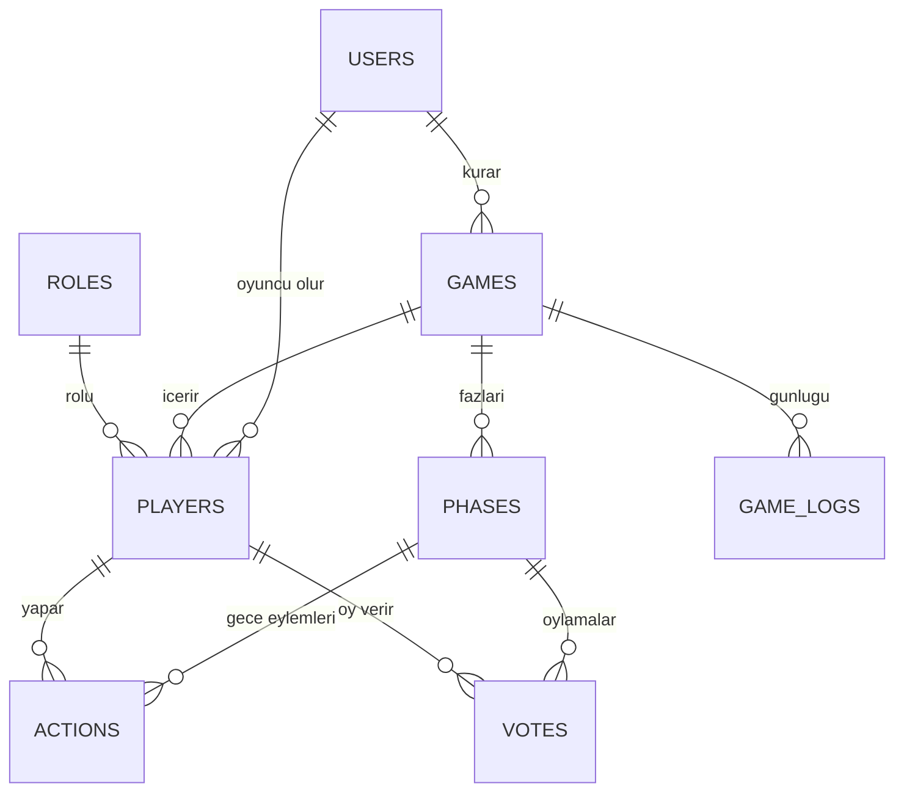
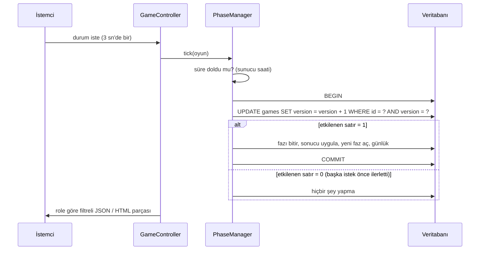

# Vampir Köylü – Uygulama Notları

Bu belge, ekibin [tasarım belgesindeki](tasarim.md) kararların kodda nasıl uygulandığını anlatır ve tasarım belgesinden ayrılan yerleri listeler. Kodu okuyacak kişi için bir rehberdir; gereksinimler [SRS](srs.md), testler [test raporu](test-raporu.md) içindedir.

## 1. Mimari

PHP 8.2, Composer ile otomatik yükleme (PSR-4, `VampirKoylu\` → `src/`). Laravel gibi bir framework kullanılmaz. Kod dört katmana ayrılır; her katman yalnızca altındakini bilir.

```
Tarayıcı
   │  HTTP
   ▼
public/index.php  (ön denetleyici)
   │
   ▼
Http\Application ── CSRF denetimi, rota eşleme, yetki (auth / guest / admin)
   │
   ▼
Controllers\*      isteği alır, servisi çağırır, yanıt döndürür (iş kuralı içermez)
   │
   ▼
Services\* ve Game\*   tüm oyun kuralları burada (Aşama 2 ve 3'te aynıdır)
   │  yalnızca arayüzleri görür
   ▼
Repositories\*Interface
   ├── Repositories\Json\*   Aşama 2: veriler JSON dosyalarında
   └── Repositories\Pdo\*    Aşama 3: MySQL, PDO + hazırlıklı ifadeler

Views\*            PHP şablonları (controller'dan gelen veriyi $e() ile kaçırarak basar)
```

Hangi depolamanın kullanılacağı `config/config.php` içindeki `depolama` ayarıyla (`json` ya da `mysql`) seçilir. Servisler ve testler iki uygulamayla da aynen çalışır.

### 1.1 Kullanılan tasarım desenleri

| Desen | Nerede | Neden |
| --- | --- | --- |
| **Repository** | `Repositories\*Interface` + `Json\*` ve `Pdo\*` uygulamaları | Aşama 2'den 3'e geçerken iş kuralı koduna dokunulmaz; yalnızca depolama değişir. |
| **Durum makinesi (State)** | `Game\PhaseManager` | Faz geçişleri tek yerden, tek kuralla yapılır: lobi → gece → gündüz → oylama → gece ... → bitiş. |
| **Strategy** | `Game\TargetRules\*` (VampireRule, DoctorRule, SeerRule, TrapperRule) | Hedef kuralları rolden role değişir; her rol kendi kuralını taşır, `GameService` rol türüne göre dallanmaz. |
| **Dependency Injection** | `Core\Bootstrap` + `Core\Container` | Her servis Bootstrap'ta açıkça kurulur; servisler arayüzlere bağımlıdır, testlerde sahte saat ve bellek içi veritabanı verilir. |
| **Factory** | `JsonRepositoryFactory`, `PdoRepositoryFactory`, `Core\Bootstrap` | Depolamaya göre doğru repository paketini kurar. |
| **Front Controller + Router** | `public/index.php`, `Http\Router`, `config/routes.php` | Tüm adresler tek yerde; ara katmanlarla (auth/guest/admin) yetki. |
| **Value Object** | `Models\*` (salt okunur sınıflar, enum'lar) | Rol, faz, takım gibi sabitler enum'dur; yanlış değer yazılamaz. |

### 1.2 Klasör yapısı

```
config/          config.php (varsayılanlar), routes.php, config.local.example.php
database/        schema.sql (tablolar + roller), seed.sql (örnek veri)
bin/             ornek-veri.php (JSON/MySQL'e örnek veri), seed-sql-uret.php (seed.sql üretir)
public/          index.php, .htaccess, assets/css/app.css, assets/js/oyun.js
src/
  Core/          Container, Bootstrap
  Http/          Application, Router, Request, Response, Session, Csrf, View
  Controllers/   Home, Auth, Room, Game, History, Admin
  Services/      AuthService, LobbyService, GameService, GameStateBuilder, NightHistory, AdminService
  Game/          GameRules, PhaseManager, NightResolver, VoteCounter, WinChecker, RoleDistributor, TargetRules/
  Models/        User, Game, Player, Phase, NightAction, Vote, GameLog ve enum'lar
  Repositories/  arayüzler, Json/ ve Pdo/ uygulamaları
  Views/         şablonlar
  Support/       Clock (saat soyutlaması)
  Dev/           GameSimulator, SampleData (yalnızca örnek veri ve test için)
storage/veri/    JSON depolama dosyaları (git'e girmez)
tests/           PHPUnit testleri
docs/            srs.md, tasarim.md, ai-gunlugu.md
```

## 2. Sınıf diyagramı ile kodun eşleşmesi

Sunumdaki 12 sınıf, kodda şu sınıflara karşılık gelir.

| Sunumdaki sınıf | Kod |
| --- | --- |
| Kullanıcı | `Models\User`, `Services\AuthService` (kayıt/giriş/çıkış) |
| Oda | `Models\Game` (oda kodu, kurucu), `Services\LobbyService` (kod üretme, katılma, sayı doğrulama, kurucu denetimi) |
| Oyun | `Models\Game` (faz, sürüm, kazanan), `Services\GameService::start`, `Services\GameStateBuilder` ("durumGörünümü") |
| Oyuncu | `Models\Player` (canlı/ölü, rol) |
| Rol | `Models\RoleType` (takım, gece eylemi, açıklama), `roles` tablosu |
| GeceEylemi | `Models\NightAction`, `actions` tablosu |
| Oy | `Models\Vote`, `votes` tablosu (hedef boşsa pas) |
| OyunGünlüğü | `Models\GameLog`, `game_logs` tablosu (gizli kayıtlar) |
| FazYöneticisi | `Game\PhaseManager` (`tick`, `beginPhase`) |
| GeceÇözücü | `Game\NightResolver` |
| OySayıcı | `Game\VoteCounter` |
| KazanmaKontrolcüsü | `Game\WinChecker` |

Tasarım belgesindeki ER diyagramından farklar (ayrıntılı liste bölüm 8'de):

- `users` tablosuna görünen ad (`name`) ve hesap türü (`account_role`: oyuncu/yönetici) eklendi. Oyuncu adlarını göstermek ve "en az 2 rol" şartı için gereklidir.
- `games` tablosuna `version` sütunu eklendi: faz geçişi için iyimser kilittir (aşağıya bakın).
- `actions` tablosuna `action_type` sütunu eklendi (öldür / koru / sorgula).
- Takım değerleri kodda `villagers` / `vampires`'tır (tasarımda `villager` / `vampire`).
- `roles` tablosunda tuzakçı (5. rol) vardır; `games.trapper_count` kurucunun seçtiği tuzakçı sayısını, `actions.is_cancelled` tuzağa takılan eylemi tutar.
- `games.vampire_count` 0 ise kurucu seçmemiştir; oyuncu sayısına göre varsayılan kullanılır.

## 3. Veritabanı

Tablo yapısı [`database/schema.sql`](../database/schema.sql) dosyasındadır; örnek veri [`database/seed.sql`](../database/seed.sql) dosyasındadır.



### 3.1 3NF gerekçesi

- **1NF:** her sütun tek değer tutar; bir satır bir oyu, bir eylemi ya da bir günlük kaydını temsil eder.
- **2NF:** her tabloda tek sütunlu anahtar (`id`) vardır; sütunlar anahtarın tamamına bağlıdır.
- **3NF:** rol türü ve takım bilgisi yalnızca `roles` tablosundadır; e-posta ve şifre yalnızca `users` tablosundadır, `players` içinde tekrar edilmez. Oyuncunun görünen adı `users`'tan JOIN ile okunur.

### 3.2 Kısıtlar

- `votes (phase_id, voter_player_id)` benzersizdir: bir oyuncu bir oylamada en fazla bir oy kaydeder (NFR-5). Boş hedef pas anlamına gelir.
- `actions (phase_id, actor_player_id)` benzersizdir: bir oyuncunun bir gecede tek eylemi vardır.
- `players (game_id, user_id)` benzersizdir: bir kullanıcı bir odaya bir kez girer.
- `phases (game_id, sequence_no)` benzersizdir; güncel faz en büyük `sequence_no`'dur.
- Oyun silinince fazlar, oyuncular, oylar ve günlük kayıtları `ON DELETE CASCADE` ile birlikte silinir.

### 3.3 İndeksler ve gerekçeleri

Benzersizlik kısıtları kendiliğinden indeks oluşturur (`room_code`, `email`, `players(game_id, user_id)`, `phases(game_id, sequence_no)`). Ek olarak:

| İndeks | Gerekçe |
| --- | --- |
| `game_logs (game_id, id)` | Her durum isteğinde "bu oyunun kayıtları, sırayla" okunur; en sık çalışan sorgudur. |
| `games (status)` | Yönetici ve oyun geçmişi listeleri duruma göre süzülür. |
| `players (user_id)` | "Bir kullanıcının oynadığı oyunlar" sorgusu `user_id` ile aranır. |

### 3.4 JOIN'li sorgular

- Oyuncu listesi: `players` ⋈ `users` (görünen ad).
- Oyun listesi: `games` ⋈ `users` (kurucu adı) + oyuncu sayısı.
- Oyuncu sıralaması: `players` ⋈ `users` ⋈ `games` ⋈ `roles` (oyuncunun takımı, kazanan takımla aynı mı).

## 4. Çekirdek problemlerin çözümü

### 4.1 Faz durum makinesi ve eşzamanlılık

`PhaseManager::tick()` her durum isteğinde çağrılır; süre dolmadıysa hiçbir şey yapmaz. Süre dolduysa:



- Zamana yalnızca `Support\Clock` bakar; istemciden gelen süre ya da faz bilgisi hiçbir yerde okunmaz.
- Koşullu `UPDATE` ve etkilenen satır sayısı kontrolüyle yalnızca ilk istek fazı ilerletir. JSON sürümünde aynı karşılaştır-ve-artır işlemi tek dosya kilidi altındadır.
- Oylamada herkes oy verince `tick`, süre dolmadan da fazı bitirir.
- Gece 25 saniyedir: ilk 15 saniye eylem seçimi, kalan 10 saniye eylemlerin uygulanması içindir. Eylemler gece sonunda, sabit sırayla (tuzaklar → vampir saldırısı ve doktor koruması → kâhin sorgusu) çözülür. Her vampir kendi hedefini seçer; farklı hedefler birden çok kişinin ölmesine yol açar, doktorun koruduğu kişi kurtulur. Tuzak, hedef eve eylem yapan ilk oyuncunun eylemini iptal eder.

### 4.2 Role özel gizli bilgi

Gizlilik kuralı yalnızca `Services\GameStateBuilder` içinde uygulanır; hem JSON uç noktası (`/oyun/{kod}/durum`) hem HTML parçası (`/oyun/{kod}/parca`) aynı diziyi kullanır. Başkasının rolü, şu durumlar dışında diziye hiç konmaz:

| Kimin rolü | Kime görünür |
| --- | --- |
| Kendi rolü | Kendisine |
| Kâhin (öldükten sonra) | Herkese |
| Kâhinin sorguladığı oyuncu | Yalnızca kâhine, sabahtan itibaren |
| Oylamayla elenen oyuncu | Herkese |
| Tüm roller | Oyun bitince herkese |

Hayalet (ölü oyuncu) yeni gizli bilgi görmez. Gece paneli yalnızca canlı ve gece yeteneği olan oyuncuya, yalnızca kendi eylemi için üretilir. Vampirler birbirini tanımaz; bu yüzden sunucu, vampirin başka bir vampiri seçmesini reddetmez (ret cevabı rolü sızdırırdı). Tuzağa takılma ve tuzak sonucu bildirimleri yalnızca ilgili oyuncuya, sabahtan itibaren gösterilir.

### 4.3 Oy sayımı, kazanma denetimi

`VoteCounter` ve `WinChecker` veritabanından bağımsız, saf sınıflardır; bu yüzden birim testleri doğrudan yazılır. Oy vermeyenler pas sayılır; en çok oyda eşitlik ya da pas çoğunluğu varsa kimse elenmez. Kazanan, her gece çözümünden ve her oylamadan sonra denetlenir.

## 5. Güvenlik

| Konu | Uygulama |
| --- | --- |
| SQL enjeksiyonu | Tüm sorgular PDO hazırlıklı ifadeleriyle çalışır; kullanıcı verisi SQL metnine eklenmez. |
| Şifre | `password_hash` / `password_verify`; en az 8 karakter, harf ve rakam. |
| XSS | Ekrana basılan her veri `$e()` (`htmlspecialchars`) ile geçer. |
| CSRF | Her POST isteği oturuma bağlı belirteçle doğrulanır (`Http\Csrf`). Silme, oy verme, eylem seçme, oda atma gibi işlemlerin hepsi POST'tur. |
| Yetki | Her rota `auth` / `guest` / `admin` ara katmanıyla korunur. Oyun sayfasını yalnızca o oyunun oyuncusu görür. |
| Oturum | HttpOnly ve SameSite=Lax çerez; girişte oturum kimliği yenilenir; 30 dakika hareketsizlikte oturum kapanır. |
| Başlıklar | `X-Content-Type-Options`, `X-Frame-Options`, `Referrer-Policy`. |
| Hata ayrıntısı | Beklenmeyen hatalarda ayrıntı gösterilmez (`hata_ayrintisi` kapalıdır). |

## 6. Arayüz

HTML, CSS ve Bootstrap 5; resim ya da çizim dosyası yoktur, simgeler emojidir. Telefonda da kullanılabilir (Bootstrap ızgarası).

| Adres | Sayfa |
| --- | --- |
| `/` | Karşılama (misafir) / oda aç - kodla katıl ve oyunlarım (üye) |
| `/kayit`, `/giris`, `/profil` | Hesap sayfaları; şifre değiştirme |
| `/kurallar` | Oyun kuralları |
| `/oyun/{kod}` | Lobi, gece, gündüz, oylama ve bitiş ekranları (aynı sayfa, faza göre içerik) |
| `/oyunlarim` | Oyun geçmişi: arama ve süzme |
| `/yonetim`, `/yonetim/kullanicilar`, `/yonetim/oyunlar` | Yönetici: özet rapor, kullanıcılar, tüm oyunlar |

### 6.1 Kısmi yenileme

`/oyun/{kod}/parca` adresi yalnızca yenilenecek bölümün HTML'ini üretir (`parca.php` kalıbı). `public/assets/js/oyun.js` bunu 3 saniyede bir `fetch` ile alıp sayfaya koyar. İşin tamamını PHP yapar; JavaScript yalnızca gelen HTML'i yerine koyar ve saniyeleri geri sayar.

- Üzerinde `data-canli` bulunan öğeler (süre, oyuncu listesi, günlük, oy dağılımı) her yenilemede yerinde güncellenir.
- Etkileşimli bölüm (formlar) yalnızca `data-imza` değişince baştan çizilir. İmza; faz, kalan seçim penceresi, oyuncunun durumu ve seçimlerinden üretilir. Böylece kullanıcı bir seçeneği işaretlerken form sıfırlanmaz.
- Hamleler (eylem seçme, oy verme, başlatma) normal form gönderimidir; sayfa yenilenir.
- Parça adresi de yetki kontrolü yapar ve oturum kilidini hemen bırakır (`session_write_close`), böylece yenileme istekleri birbirini beklemez.

## 7. Test stratejisi

PHPUnit 11. Servis testleri sahte saat (`FakeClock`) ve sabit tohumlu rastgelelikle çalışır; böylece süreler beklenmeden test edilir. Aynı testler iki depolamayla çalışır:

```
composer test      # önce PDO repository'leri (bellek içi SQLite), sonra JSON repository'leri
```

PDO katmanı, `database/schema.sql` dosyasının SQLite'a uyarlanmış hâliyle çalıştırılır; böylece MySQL şeması ile testler aynı tabloları kullanır. Aynı testler gerçek bir MySQL/MariaDB sunucusuna karşı da çalıştırılabilir (`composer test:mysql`). Gereksinim–test eşleşmesi ve karşılama durumu [test-raporu.md](test-raporu.md) içindedir.

## 8. Tasarım belgesinden ayrılan yerler

[`tasarim.md`](tasarim.md) hedef tasarımı anlatır; kod şu noktalarda ondan ayrılır. Bunlar ya kodu tasarıma uydurarak ya da tasarım belgesini koda uydurarak kapatılmalıdır (ekip kararı).

| Konu | Tasarım belgesi | Kod |
| --- | --- | --- |
| Dil ve klasörler | Türkçe sınıf adları; `src/Controller`, `Service`, `Model`, `Repository`, `Core`; `templates/`; `public/api/` | İngilizce adlar; `src/Controllers`, `Services`, `Models`, `Repositories`, `Core`, `Http`; `src/Views/`; JSON/HTML uç noktaları rotalarla (`/oyun/{kod}/durum`, `/parca`) |
| State deseni (5.1) | Her faz bir `FazDurumu` sınıfı | Yok: `PhaseManager` içinde `PhaseType` enum'u ve `match` ifadeleri |
| Strategy deseni (5.2) | Rol başına `RolKurali` stratejileri | Var: `Game\TargetRules\*` (VampireRule, DoctorRule, SeerRule, TrapperRule) |
| Repository deseni (5.3) | Yalnızca PDO repository'si | Aynı arayüzün iki uygulaması: JSON (Aşama 2) ve PDO (Aşama 3); sahte repository yerine bellek içi SQLite kullanılıyor |
| Lobi | Oda kodu ve kopyala düğmesi | Oda kodu görünür; kopyala düğmesi yok |
| Oyun günlüğü ekranı | Her fazda açılabilir ayrı ekran | Günlük oyun sayfasının içinde "Duyurular" bölümü |
| Gece ekranı | Tüm rollerin durum kartları aynı davranır (6.3) | Oyuncu yalnızca kendi rolünün panelini görür (daha katı gizlilik) |
| ER diyagramı | Bölüm 2'deki farklar | `users.name`, `users.account_role`, `games.version`, `actions.action_type` eklendi; takım değerleri `villagers`/`vampires` |
| Arayüz görseli | `docs/img/arayuz-tasarimi.png` | Görsel depoda yok (bağlantı kırık); kodda resim kullanılmıyor, emoji ve CSS var |

SRS'teki çelişkilerde alınan kararlar için `YapilmasiGerekenlerAfterClaude.md` bölüm 2'ye bakın.